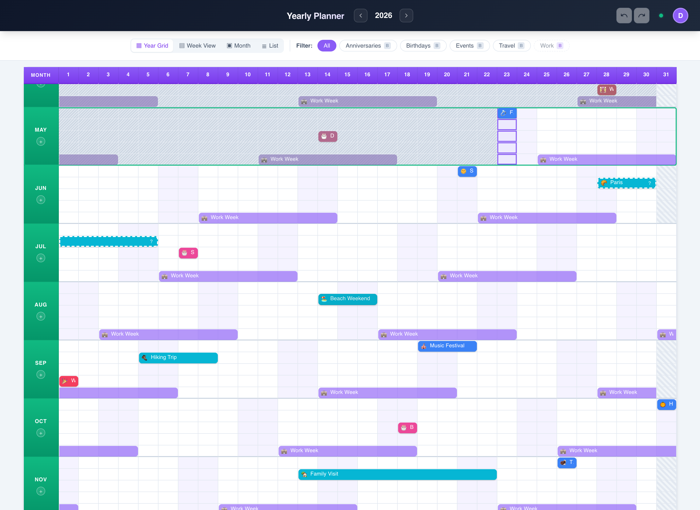

# 📅 Yearly Planner

A high-density, full-stack yearly planner web application displaying an entire year (12 months × 31 days) on a single scrollable grid. Designed for visualizing personal schedules, trips, work blocks, and goals at a glance.



## ✨ Features

- **Year-at-a-Glance Grid**: 12-month visual timeline with drag-and-drop entry management.
- **Multiple Views**: Seamlessly switch between Year Grid, Week-Year List, Month View, and Agenda List.
- **Task & Comments Layer**: Maintain todo lists and collaborative logs directly inside event details.
- **Works Offline**: Installable PWA; entries are stored locally and sync when you're back online.
- **Dev Login**: Built-in developer login skips Google OAuth during local runs (disabled in production).

---

## 🚀 Quick Start (Development)

```bash
git clone https://github.com/vkotaru/yearly.app.git
cd yearly.app
./dev.sh
```

`./dev.sh` installs dependencies, creates template `.env` files if missing, and starts the server (`:3001`) and client (**`http://localhost:5173`**). Use the dev login to get in.

For sample data, run `npm run seed`, or use `./run-dev.sh`, which re-seeds on every start. ⚠️ `./run-dev.sh` **deletes all entries for the current year** first, so don't use it on data you want to keep.

---

## 🛠️ Configuration

Copy `server/.env.example` to `server/.env`:

```env
GOOGLE_CLIENT_ID=your_google_client_id
GOOGLE_CLIENT_SECRET=your_google_client_secret
JWT_SECRET=your_jwt_secret          # openssl rand -base64 32
ALLOWED_EMAILS=you@example.com      # comma-separated emails and/or @domains
FRONTEND_URL=http://localhost:5173
```

And in `client/.env`:

```env
VITE_GOOGLE_CLIENT_ID=your_google_client_id   # same as the server's
```

**`ALLOWED_EMAILS` is required for Google sign-in.** If it's empty, every login is rejected.

---

## 📦 Deployment

Runs on any Node host with a persistent disk. Railway config is included ([nixpacks.toml](nixpacks.toml), [railway.json](railway.json)):

1. Link your repository in Railway.
2. Mount a persistent disk volume at `/data` (for SQLite storage).
3. Set `DATABASE_PATH=/data/yearly.db`, plus the variables above.
4. Set `FRONTEND_URL` to your production origin to enable CORS headers.

---

## 🧑‍💻 Contributing / Technical details

Architecture, sync design, and gotchas are in [AGENTS.md](AGENTS.md).

---
*Vibe coding for the win!*
